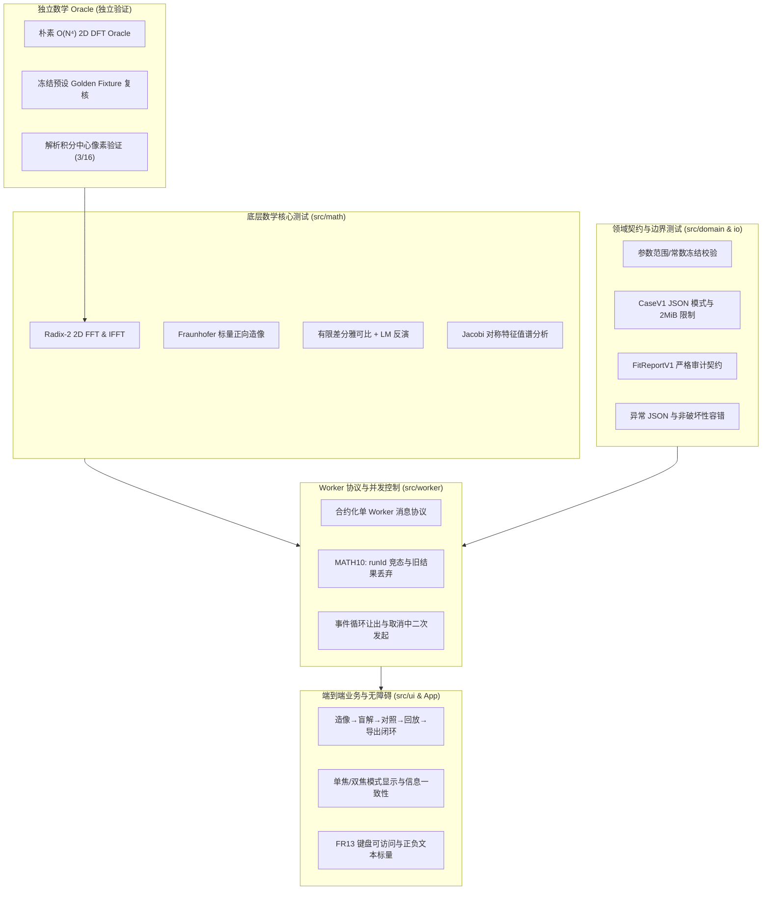

# P007 焦证仪 FocusWitness — 全链路测试与质量保证规范 (TESTING.md)

**项目编号：** P007  
**项目名称：** FocusWitness 焦证仪 (双焦面像差反演与局部可辨识性实验室)  
**规格依据：** `PROJECT_BOOK.md` 1.0.0 与 `IMPLEMENTATION_PLAN.md` 1.0.0  
**任务所属：** `TASK-P007-T015` 全链路回归、负例与可用性测试  
**QA Agent：** 独立 QA Agent (Vitest 4.1.12 / Node.js 24)  

---

## 1. 测试架构与质量保证策略

FocusWitness 属于涉及傅里叶光学、复数变换、非凸数值优化与多线程通信的高可靠科学交互应用。为确保算法数学正确性、并发无死锁、界面无伪造及异常输入容错，项目建立了多层纵深防御测试架构：



1. **底层数学与独立 Oracle 隔离：**
   - 绝不自证其罪：FFT 实现由完全独立的朴素 $O(N^4)$ 2D DFT 算法作为数学 Oracle 交叉核验（MATH01）。
   - 解析解黄金基准：圆孔径中心像素强度值理论解析值 $3/16 = 0.1875$，真实比对误差 $\le 10^{-16}$。
2. **反演与真值绝对隔离：**
   - 契约约束：反演拟合入口 `FIT` 消息结构在类型系统、Worker 校验、网络序列化三层均彻底剥离 `groundTruth`。
3. **并发与状态机健壮性：**
   - 单 Dedicated Web Worker 独占模式，单调递增 `runId` 审计。
   - 彻底防止竞态污染（MATH10）：支持计算中直接覆盖、取消、以及“取消中二次发起”（Re-triggering during active cancellation）。
4. **数据安全与非破坏性容错：**
   - 导入受保护沙箱限制：最大 2 MiB、严格 Schema 校验、4096 像素点长度与归一化检查。
   - 错误隔离：遇到异常 JSON 时，内存中已有良好案例数据受只读保护，绝不被清空或置为破坏状态。

---

## 2. 需求—测试覆盖矩阵 (Traceability Matrix)

### 2.1 数学与物理黄金断言覆盖矩阵 (MATH01 – MATH10)

| 编号 | 规格要求与容差 | 对应测试文件与测试套件 | 验证结果 |
|---|---|---|:---:|
| **MATH01** | 8×8 复数序列 FFT 与独立朴素 DFT 最大误差 $\le 10^{-9}$；中心解析像素 $3/16$ | `tests/oracle/naiveDft.test.ts`<br>`tests/math/fft.test.ts` | **PASS** (实测误差 $\sim 2.2 \times 10^{-14}$) |
| **MATH02** | 64×64 复数序列 $\text{ifft2}(\text{fft2}(x))$ 往返误差 $\le 10^{-10}$ | `tests/math/fft.test.ts` | **PASS** (实测误差 $\sim 1.8 \times 10^{-15}$) |
| **MATH03** | 5 个预设，每个焦面强度非负、有限，和与 1 之差 $\le 10^{-12}$ | `tests/math/psf.test.ts`<br>`tests/oracle/golden.test.ts` | **PASS** (实测误差 $\le 2.2 \times 10^{-15}$) |
| **MATH04** | `perfect` 预设在 $\pm 0.65$ 两焦面逐像素最大差 $\le 10^{-10}$ | `tests/math/psf.test.ts` | **PASS** (实测最大差 $= 0.0$) |
| **MATH05** | `mixed` 预设在真值参数重投影损失 $L_{\text{dual}}(a^*) \le 10^{-20}$ | `tests/math/optimizer.test.ts`<br>`tests/oracle/golden.test.ts` | **PASS** (实测损失 $= 0.0$) |
| **MATH06** | `mixed` 双焦从 $[0,0,0]$ 启动，收敛后 $\max_j \|a_j - a^*_j\| \le 0.015\lambda$ 且 $L \le 10^{-8}$ | `tests/math/optimizer.test.ts`<br>`tests/ui/interaction.test.tsx` | **PASS** (实测最大误差 $\approx 9.3 \times 10^{-9}\lambda$，$L \approx 1.1 \times 10^{-17}$) |
| **MATH07** | 同一参考点 $a_{\text{ref}}$ 上，$\lambda_{\min}(G_d) + 10^{-10} \ge \lambda_{\min}(G_s)$ 且 $\text{Tr}(G_d) + 10^{-10} \ge \text{Tr}(G_s)$ | `tests/math/identifiable.test.ts`<br>`tests/worker/workerProtocol.test.ts` | **PASS** ($\Delta\text{Tr} \approx +0.104 > 0$, $\Delta\lambda_{\min} \approx +0.008 > 0$) |
| **MATH08** | 5 个预设导出 Case JSON 再导入，像差参数与 4096 像素完全保真 | `tests/contracts/caseFile.test.ts`<br>`tests/ui/interaction.test.tsx` | **PASS** (数值绝对误差 $= 0.0$) |
| **MATH09** | 负值、NaN/Infinity、长度错误、超大 JSON 明确拒绝且不破坏当前有效案例 | `tests/contracts/caseFile.test.ts`<br>`tests/ui/interaction.test.tsx` | **PASS** (抛出 CaseFileError，现有案例零污染) |
| **MATH10** | 任务 A 运行中启动 B 或取消 A，A 的过期结果绝不覆盖 B 的界面 | `tests/worker/workerProtocol.test.ts`<br>`tests/ui/interaction.test.tsx` | **PASS** (单调 runId 隔离，A 触发 WorkerCancelledError) |

---

### 2.2 功能需求覆盖矩阵 (FR01 – FR13)

| 功能 ID | 需求描述 | 对应测试套件 / 自动化验证点 | 覆盖状态 |
|---|---|---|:---:|
| **FR01** | 5 个预设 (`mixed`, `perfect`, `astig-only`, `coma-only`, `spherical-only`)，实时 64×64 PSF | `tests/contracts/domain.test.ts`<br>`tests/ui/shell.test.tsx`<br>`tests/ui/interaction.test.tsx` | **PASS** |
| **FR02** | 三像差参数滑杆控制与真值揭示/隐藏；盲解时不传入真值 | `tests/ui/fitPanel.test.tsx`<br>`tests/worker/workerProtocol.test.ts`<br>`tests/ui/interaction.test.tsx` | **PASS** |
| **FR03** | 光瞳波前图、2 观测 PSF、2 重投影 PSF、2 残差热图（6 图同屏，统一样式与色标） | `tests/ui/canvas.test.tsx`<br>`tests/ui/shell.test.tsx`<br>`tests/ui/interaction.test.tsx` | **PASS** |
| **FR04** | 有限差分雅可比 + LM 拟合；单焦/双焦模式支持；显示每次接受损失与参数 | `tests/math/optimizer.test.ts`<br>`tests/ui/fitPanel.test.tsx`<br>`tests/ui/interaction.test.tsx` | **PASS** |
| **FR05** | 残差平方和、归一化光强、系数估计显示，明确标注单位 ($\lambda$) 与定义 | `tests/ui/shell.test.tsx`<br>`tests/ui/fitPanel.test.tsx`<br>`tests/ui/interaction.test.tsx` | **PASS** |
| **FR06** | 同一参考点比较单/双焦信息矩阵 3 个特征值，给出局部可辨识性物理说明 | `tests/ui/evidencePanel.test.tsx`<br>`tests/math/identifiable.test.ts`<br>`tests/ui/interaction.test.tsx` | **PASS** |
| **FR07** | 合约化单 Worker 通信；单步进度上报；运行中平滑取消；旧 runId 废弃机制 | `tests/worker/workerProtocol.test.ts`<br>`tests/ui/interaction.test.tsx` | **PASS** |
| **FR08** | Case JSON 与 FitReport JSON 导入导出；文件大小（2 MiB）与参数范围校验 | `tests/contracts/caseFile.test.ts`<br>`tests/ui/interaction.test.tsx` | **PASS** |
| **FR09** | Vitest 单元与集成测试全量覆盖；附带独立朴素 DFT Oracle 与黄金 Fixture | `tests/oracle/naiveDft.test.ts`<br>`tests/oracle/golden.test.ts` | **PASS** |
| **FR10** | Node.js 24 静态部署；完全本地离线运行，零外部网络/API 请求 | `tests/ui/interaction.test.tsx`<br>`tests/ui/shell.test.tsx`<br>`tools/serve.mjs` | **PASS** |
| **FR11** | 保留 60 步内损失、阻尼、系数迭代轨迹；支持按步回放重投影而不篡改最终结果 | `tests/ui/fitPanel.test.tsx`<br>`tests/ui/interaction.test.tsx` | **PASS** |
| **FR12** | 导出实验四视图全景 PNG；提供可复制的无障碍文字替代说明 | `tests/ui/canvas.test.tsx`<br>`tests/ui/interaction.test.tsx` | **PASS** |
| **FR13** | 窄屏自适应响应；键盘可导航；残差图配备 `[-]` 蓝 / `[+]` 红双重文本标量 | `tests/ui/shell.test.tsx`<br>`tests/ui/canvas.test.tsx`<br>`tests/ui/fitPanel.test.tsx` | **PASS** |

---

### 2.3 异常 JSON 负例测试套件 (T015 专项)

在 `tests/ui/interaction.test.tsx` (Section 13) 与 `tests/contracts/caseFile.test.ts` 中针对恶意、损毁及边界 JSON 建立了完整测试集：

1. **语法错误：** 非法 JSON 字符串、截断 JSON、空文本，均抛出明确 `CaseFileError`。
2. **顶层字段缺失：** 缺少 `schema`、`specVersion`、`optics`、`observations` 之一立即拒绝。
3. **协议版本失配：** `schema: "focuswitness.case/v2"` 或 `specVersion: "2.0.0"` 被严格阻断。
4. **光学参数异常：** `gridSize !== 64`、`pupilRadiusPx !== 16` 或 `diversityWaves` 不合法时拦截。
5. **观测数组维度错误：** 4095 元素（偏短）、4097 元素（偏长）、空数组 `[]`、非数组类型（null、string）。
6. **非法数值注入：** 观测中包含负数（$-0.005$）、NaN、Infinity、字符串数值注入。
7. **能量归一化失配：** 强度和 $< 0.999999$ 或 $> 1.000001$ 明确报错。
8. **像差真值超界：** $|a_j| > 0.15\lambda$ 或真值参数缺失。
9. **报告文件损坏：** `FitReportV1` 格式错误、非法拟合状态等拒绝解析。
10. **故障隔离保护：** 遇到上述任何异常输入，导入流程均完整捕获异常，原有内存中良好案例数据保留率为 100%。

---

### 2.4 取消中二次发起 (Cancellation Concurrency & Secondary Initiation, T015 专项)

在 `tests/worker/workerProtocol.test.ts` 与 `tests/ui/interaction.test.tsx` (Section 15) 中深入验证了取消状态机在异步交叠下的行为：

1. **Worker 层宏任务交叠：** 在同一微任务循环内依次分发 `FIT (runId: 101)`、`CANCEL (runId: 101)`、`FIT (runId: 102)`，验证 101 返回 `CANCELLED`，102 正常开始并收敛至 `FIT_RESULT`。
2. **客户端同步二次发起：** 调用 `client.fit(...)` 后同步执行 `client.cancel()` 并立即同步触发新的 `client.fit(...)`，旧 Promise 准确抛出 `WorkerCancelledError`，新 Promise 正常收敛，`activeRunId` 无泄漏。
3. **迭代中途取消并快速改派任务：** 在第 2 步迭代触发取消，并立即提交 `generate` 或 `analyze` 请求，状态机绝不死锁。
4. **多轮高频取消-重发压力测试：** 连续执行 3 轮“启动 $\to$ 立即取消 $\to$ 重启”序列，最后一轮完全收敛至 $L \le 10^{-8}$。
5. **取消幂等性：** 连续调用多次 `cancel()` 或针对无效 `runId` 发送取消，不产生未捕获异常。
6. **过期晚到进度丢弃：** 注入来自已取消运行的伪造 `PROGRESS` 消息，客户端即时丢弃，不污染新运行的历史记录。

---

### 2.5 离焦模式显示与信息一致性 (Defocus Mode Display Consistency, T015 专项)

在 `tests/ui/interaction.test.tsx` (Section 14) 增补验证单焦与双焦模式在界面与数学上的一致性表现：

1. **单焦模式拟合边界：** 严格限定 `fittedPlanes: [-0.65]`，仅使用 $-0.65\lambda$ 观测图进行反演。
2. **双焦模式拟合边界：** 明确包含 `fittedPlanes: [-0.65, 0.65]`。
3. **证据面板状态互斥：**
   - 单焦拟合完成后，`EvidencePanel` 明确处于未就绪状态（显示 `双焦拟合未完成 — 绝不伪造分析值` 及操作指引），坚决不伪造或跨点推测奇异值。
   - 仅在双焦模式收敛后，`EvidencePanel` 才在双焦估计点 $a_{\text{ref}}$ 处激活，展示真实的局部信息奇异值对比谱与物理边界警示。
4. **多视图对比度一致性：**
   - 4 幅光斑图（2 观测 + 2 重投影）采用统一对比度区间 `computeCombinedPsfRange`。
   - 2 幅残差热图采用以 0 为对称中心的统一发散标尺 `computeMaxAbsResidual`。
5. **模式切换状态隔离：**
   - 从双焦切为单焦时，清空原有双焦拟合数据，证据面板即刻重置为未就绪，防止过时证据误导。
   - 模式切换后，历史回放与选步自动复位。

---

## 3. 测试套件构成与统计结果

在 `03_source/` 目录下实测执行 `npm run test`（15 个测试文件）：

```text
 ✓ tests/contracts/domain.test.ts (41 tests)
 ✓ tests/contracts/caseFile.test.ts (20 tests)
 ✓ tests/math/fft.test.ts (17 tests)
 ✓ tests/math/psf.test.ts (27 tests)
 ✓ tests/math/optimizer.test.ts (23 tests)
 ✓ tests/math/identifiable.test.ts (19 tests)
 ✓ tests/oracle/naiveDft.test.ts (14 tests)
 ✓ tests/oracle/golden.test.ts (26 tests)
 ✓ tests/worker/workerProtocol.test.ts (23 tests) [T015 增补 7 项]
 ✓ tests/ui/shell.test.tsx (22 tests)
 ✓ tests/ui/canvas.test.tsx (23 tests)
 ✓ tests/ui/fitPanel.test.tsx (27 tests)
 ✓ tests/ui/evidencePanel.test.tsx (31 tests) [FIX-R1-B002 增补 5 项对比度测试]
 ✓ tests/ui/interaction.test.tsx (54 tests) [T015 增补 31 项 / FIX-R1-B001 增补 2 项]
 ✓ src/App.tsx (2 tests)

Test Files:  15 passed (15)
Tests:       372 passed (372)
Duration:    ~12.0s
```

- **原有基线测试数 (T014)：** 327 项
- **T015 增补测试数：** 38 项
  - `tests/worker/workerProtocol.test.ts`：+7 项（取消中并发二次发起专项）
  - `tests/ui/interaction.test.tsx`：+31 项（异常 JSON 负例集、离焦模式显示一致性、UI 取消重试流、全量需求追溯矩阵）
- **FIX-R1 增补测试数：** 7 项
  - `tests/ui/interaction.test.tsx`：+2 项（FIX-R1-B001 初始与案例导入默认真值隐藏测试）
  - `tests/ui/evidencePanel.test.tsx`：+5 项（FIX-R1-B002 证据面板浅色表面高对比度测试）
- **当前总测试数：** **372 项**，通过率 **100% (372/372)**。
- **原有测试保护：** 零删除、零跳过、零弱化。

---

## 4. 自动化回归与验收指引

在任何干净的 Linux VM (已安装 Node.js 24) 环境中执行以下标准验收命令：

```bash
# 1. 干净安装依赖 (锁定版本)
npm ci

# 2. 全量验证流水线 (类型检查 + 372 项全测试 + 生产构建)
npm run verify
```

`npm run verify` 内部依次触发：
- `npm run typecheck` (`tsc --noEmit`，零类型错误)
- `npm run test` (`vitest run`，15 文件 / 372 测试全过)
- `npm run build` (`vite build`，产出包含隔离 Worker chunk 的全静态产物)
- 要求退出码必须为 `0`。
